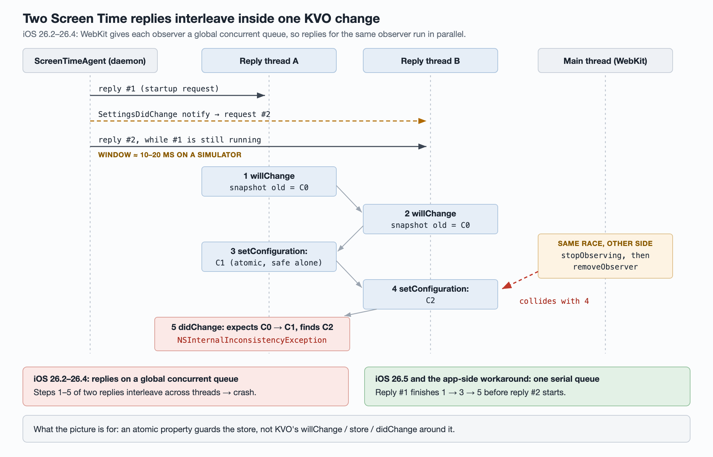
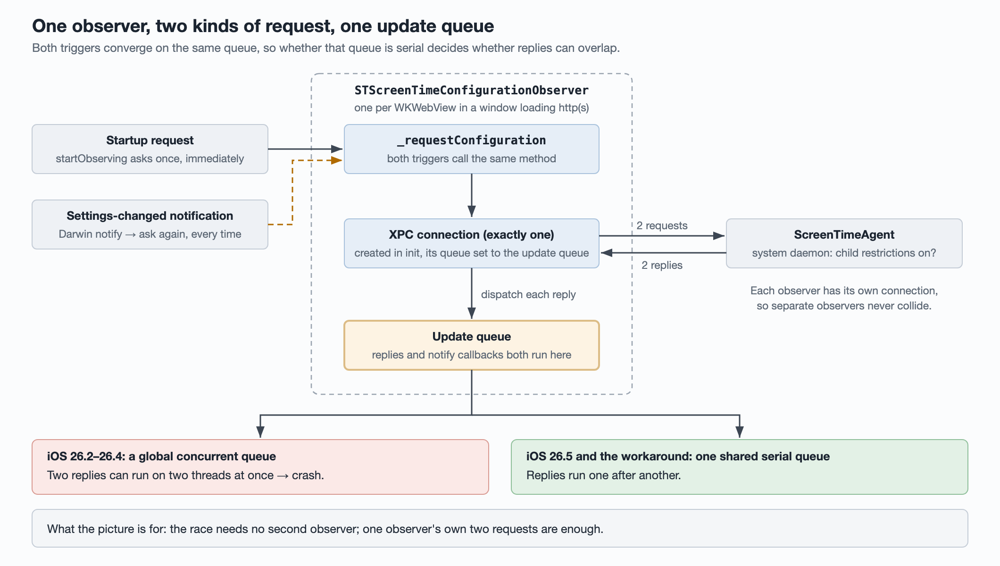

# A WebKit KVO race on iOS 26.2–26.4: serializing Screen Time observer replies from the app side

One release of an iOS app started crashing on cold launch for 7% of its users on
iOS 26.2–26.4, up from 0.4% in the previous release. Every other OS version was
at zero. The crash is a concurrency bug inside Apple's WebKit, already fixed in
iOS 26.5; the app-side workaround below copies the 26.5 fix. Why this
particular release made a long-standing system bug fifteen times more likely is
still open, and the article says so where it matters.

**Status:** root cause confirmed by disassembly; the workaround is confirmed on
an iOS 26.4 simulator. The original crash never reproduced locally, so its
effect in production is pending the next release.

## 1. What the crash data said

Users crashed within about three seconds of a cold launch, mostly on the first
launch after updating the app. 287 of 302 crashes were in the foreground, so
this was not a background wake.

Users on iOS 26.2–26.4, crash reporter export, last 25 days, deduplicated by
installation:

| App release | Users | Crashed users | Rate |
| --- | ---: | ---: | ---: |
| N + hotfix | 123 | 4 | 3.3% |
| N | 4,157 | 289 | 7.0% |
| N − 1 | 3,716 | 15 | 0.40% |
| N − 2 | 4,078 | 23 | 0.56% |

The same release had zero crashes on iOS 26.5 and later (about 227,000 users)
and on iOS 26.0 / 26.1 (about 500). That shape — one OS range, every release,
one release much worse — points at a system bug that the app started hitting
more often.

The release also shipped a major upgrade of the crash reporter SDK, which
regroups crashes. That was ruled out as the cause of the jump: total fatal-crash
users on iOS 26.2–26.4 rose from 47 to 317, and no other issue shrank to
compensate. When a spike coincides with a crash-reporter upgrade, check the
total before trusting the per-issue number.

## 2. Root cause: KVO bookkeeping is not atomic

WebKit creates one `STScreenTimeConfigurationObserver` for every `WKWebView`
that is in a window and loading an http(s) URL. It uses it to ask whether
Screen Time child restrictions are on. On iOS 26.2–26.4, WebKit passes that
observer a **global concurrent queue**, so several XPC replies for the *same*
observer can execute at the same time on different threads.



WebKit observes the nested key path `configuration.enforcesChildRestrictions`.
For a nested key path, KVO records the old value in `willChange` and, in
`didChange`, moves its inner observation from the old `configuration` object to
the new one. `setConfiguration:` is an `atomic` property, but atomic only
protects the single store. The sequence `willChange` → store → `didChange` is
not atomic, and two replies interleaving inside it leave KVO with bookkeeping
that no longer matches the object, which it reports by throwing.

A second signature rose in the same window: the main thread removing the KVO
observer while a reply is mid-update. It is the same race seen from the other
side.

### Why one observer gets two replies at once



- **Startup request.** `startObserving` immediately asks the system daemon
  (ScreenTimeAgent) over XPC whether child restrictions are on — once per
  observer.
- **Settings-changed notification.** It also subscribes, via
  `notify_register_dispatch`, to the Darwin notification
  `com.apple.ScreenTimeAgent.SettingsDidChangeNotification`. Each time the
  daemon posts it, every observer in every app asks again.
- Both requests go over the observer's one connection and both replies land on
  its one update queue. If the notification arrives before the previous reply
  finishes (about 10–20 ms on a simulator), the two replies overlap. Separate
  observers have separate connections and never collide with each other.

When that notification fires in production is **not confirmed**. The best
explanation is that updating an app makes the system refresh its Screen Time
registration, which fits "first launch after upgrading".

**Checking `self` does not help.** The reply block holds the observer strongly
(unlike the notification handler, which goes through `objc_loadWeakRetained`),
so `self` is always alive while a reply runs. `stopObserving` only unsubscribes
from the notification; it does not cancel in-flight requests. WebKit then calls
`removeObserver` on the main thread, and if a reply is in `setConfiguration:` on
another thread at that moment, KVO's add/remove and its change tracking collide.

A serial queue removes reply-versus-reply collisions. Main-thread removal versus
a reply is still possible in theory, but iOS 26.5's WebKit has exactly that
design and shows zero crashes across about 200,000 users, so it is negligible
in practice.

### What changed between OS versions

| iOS | Queue WebKit passes to the observer | Evidence |
| --- | --- | --- |
| 26.5 | `dispatch_queue_create("com.apple.WebKit.ScreenTimeUpdateQueue", NULL)` — one serial queue shared by the process | Disassembly of `-[WKScreenTimeConfigurationObserver startObserving]` |
| 26.4 | `dispatch_get_global_queue(0, 0)` — concurrent | Same |
| 26.2 / 26.3 | Presumed the same as 26.4 | Inferred from the crash distribution; no runtime available to disassemble |

## 3. The workaround: hand the observer a serial queue

Do what iOS 26.5 does, from inside the app: replace
`-[STScreenTimeConfigurationObserver initWithUpdateQueue:]` so that when the
caller passes the default global queue, the observer gets one shared serial
queue instead.

```swift
import ScreenTime  // link directly: at launch WebKit may not have loaded it yet

private let screenTimeQueue = DispatchQueue(label: "com.example.ScreenTimeUpdateQueue")

// Inside the replacement for -initWithUpdateQueue:
let queue = (passed === DispatchQueue.global()) ? screenTimeQueue : passed
```

Keep the blast radius as small as the bug:

- **Install only on iOS 26.2–26.4** — about 1.8% of the affected release's
  users. The only caller is WebKit.
- **Match the queue by object identity**, not by label prefix, and pass every
  other queue through unchanged.
- **Guard it with a remote kill switch that is on when unconfigured.** Not an
  A/B experiment: the crash happens on the first launch after an update, before
  experiment config has been fetched, and a default-off experiment would not be
  active on exactly the launch that needs it.
- **Write a crash-reporter key the first time a queue is actually replaced.**
  Remaining crashes then split cleanly into "replaced and still crashed"
  (another trigger exists) and "never replaced" (the identity match missed).

**The trap that made the first version useless:** the first implementation
looked the class up by name. At launch WebKit has not yet loaded the ScreenTime
framework on demand, so `NSClassFromString` returned `nil` and nothing was
installed, while the unit tests still passed — a false green. Importing
`ScreenTime` directly links it and fixes the lookup. Only an app-level check (below) caught it.

**An aside on swizzles.** Review suggested moving the swizzle mechanics into one
shared helper, done as a separate change. It found four Swift swizzles in the
codebase, moved all of them behind replace / restore / exchange functions that
report a non-fatal when a method is missing, and added a lint rule that allows
the Objective-C runtime's method-replacement functions only in that one file.

## 4. Why this release? Still open

The system bug was always there and the user base did not change, so something
in this release makes WebViews hit it more often early in launch. The change
responsible has not been found.

| Hypothesis | What was checked | Result |
| --- | --- | --- |
| Migration to the UIScene lifecycle (an automated triage bot's medium-confidence guess) | iOS 26.4 simulator, builds just before and just after the change, same dependencies; cold launch by icon tap, by silent push, and with a forced launch ad | No difference: 13–14 WebViews and 3–4 observers in each, none destroyed during launch |
| SDK upgrades (ad mediation, Firebase) | Same probe against the shipped build | No difference; production ran almost a single build, so it cannot be split by build number either |
| Crash reporter regrouping old crashes | Compared all fatal crashes by version | Ruled out — the total really rose |
| A launch-ad frequency experiment | Crash rate by experiment arm | Treatment 9.9% vs. control 4.4%: explains about 2×, but control also rose more than 10× |

Every clue points at the launch-ad path: crashes land about three seconds after
the launch screen, and more launch ads mean more crashes. A simulator cannot
load production HTML ad creatives and cannot tap the ad's close button (a
system alert covers it). So the same change adds crash-reporter keys that record
the launch ad's stage, the stage's timestamp and the ad network; the next
release's crashes will say which stage they died in.

"Not shown to be related" is not "shown to be unrelated". The UIScene change
was probed and showed no difference, which leaves it unconfirmed either way —
write it down that way.

## 5. Verification

| Check | Result |
| --- | --- |
| App level, in lldb: which queue the WebKit-created observer's replies run on | Before: `com.apple.root.default-qos`. After: all on the app's serial queue, including replies triggered by the settings notification |
| Marker key | Written exactly once, on the first real replacement |
| Launch-ad diagnostic keys | One cold launch records loading → loaded → will display (with network) → shown |
| Unit tests | All 217 pass on iOS 26.4; removing the queue replacement makes the key tests fail (mutation check) |
| New crashes | Fix build and baseline build cold-launched 5 times each with no new crash. A widget extension crash that appeared that day showed up only on the baseline build |

**Not verified:** on-device timing, the original crash itself, and the WebKit
implementation on 26.2 / 26.3 (no runtime available; assumed identical to 26.4
from the crash distribution).

## 6. Checking it after release

Expected outcome: on iOS 26.2–26.4, the crashed-user rate for this signature in
the release containing the fix returns below 0.4%.

1. In the crash-reporter export, group by app version, keep only iOS 26.2–26.4,
   and divide crashed users for this issue by all users of that version on that
   OS range.
2. Draw no conclusion while the fixed release has fewer than 1,000 users on that
   OS range.
3. Split what remains by the marker key — present means another trigger path,
   absent means the identity match missed — then by the launch-ad keys, to find
   what this release amplified.
4. Also watch launch hangs and launch time on that OS range: serialized replies
   now queue behind each other.

## References

- [`STScreenTimeConfigurationObserver`](https://developer.apple.com/documentation/screentime/stscreentimeconfigurationobserver) — the public ScreenTime API WebKit uses.
- [Key-Value Observing Programming Guide](https://developer.apple.com/library/archive/documentation/Cocoa/Conceptual/KeyValueObserving/KeyValueObserving.html) — `willChange` / `didChange` and key-path observation.
