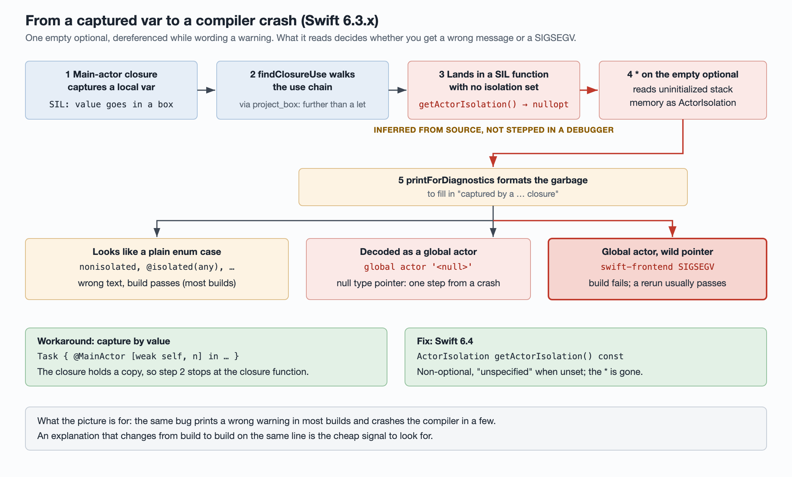

# swift-frontend crashing in SendNonSendable: Swift 6.3 reads an empty optional while wording a warning

A CI test build failed with `TEST BUILD FAILED` and no compile error at all —
only a `swift-frontend` crash. A rerun passed. This is a Swift 6.3.x compiler
bug, not a problem in the app's code: while composing the explanatory text for a
`sending 'x' risks causing data races` warning, the compiler dereferences an
empty `std::optional<ActorIsolation>` and reads uninitialized memory. When the
garbage looks like an ordinary enum value the warning text is simply wrong; when
it decodes to a bad pointer, `swift-frontend` segfaults. That is why it is
intermittent.

Swift 6.4 fixes it. Until you move to a 6.4 toolchain, capturing the variable
by value sidesteps it.



## 1. Symptom

The crash happens in SIL pass `SendNonSendable`, while processing one function.
The frames that matter:

```
4  ActorIsolation::printForDiagnostics(...)
5  SILIsolationInfo::printActorIsolationForDiagnostics(...)
7  SentNeverSendableDiagnosticInferrer::initForIsolatedPartialApply(Operand*, AbstractClosureExpr*, optional<ActorIsolation>)
8  SendNonSendableImpl::emitVerbatimErrors()
9  SendNonSendable::run()
```

A crash while *printing a diagnostic* is the first hint: nothing about the
program is being rejected, the compiler is failing to describe a warning.

## 2. How often, and on which toolchains

CI only uploads logs for failed runs and keeps them about seven days. In one
week there were 33 failed-run logs; this stack appeared in 2 of them, both in
the same function, once on Swift 6.3.0 and once on 6.3.3. The second passed on
rerun. The CI fleet mixed two Xcode versions and both were hit.

| Xcode | Swift | Status | Evidence |
| --- | --- | --- | --- |
| 26.0 – 26.3 | 6.2.x | Not verified | Not installed locally; absent from a week of CI |
| 26.4 | 6.3.0 | Affected | CI crash |
| 26.6 | 6.3.3 | Affected | CI crash; the local minimal repro prints the wrong isolation |
| 27.1 | 6.4.0 | Fixed | Minimal repro prints the correct isolation |
| 27.2 | 6.4.2 | Fixed | Minimal repro prints the correct isolation |

## 3. When it triggers

All three must hold to reach the faulty code, and even then it only crashes
when the garbage happens to be a bad pointer:

- The compiler is Swift 6.3.x.
- A main-actor closure — `Task { @MainActor in … }` or
  `DispatchQueue.main.async { … }` — captures a local `var` **by reference**:
  the closure uses the outer `var` directly instead of listing it in a capture
  list.
- That closure produces a region-isolation warning,
  `sending 'x' risks causing data races`. Building with
  `-enable-upcoming-feature StrictConcurrency` is enough to get these.

## 4. Root cause

In 6.3, `SILFunction::getActorIsolation()` can return an empty optional:

```cpp
// include/swift/SIL/SILFunction.h (release/6.3.1)
std::optional<ActorIsolation> getActorIsolation() const { return actorIsolation; }
```

The function that builds the warning's explanation dereferences it without
checking:

```cpp
// lib/SILOptimizer/Mandatory/SendNonSendable.cpp (release/6.3.1)
bool SentNeverSendableDiagnosticInferrer::initForIsolatedPartialApply(...) {
  auto diagnosticPair = findClosureUse(op);  // follow the captured value to its use in the closure
  auto *diagnosticOp = diagnosticPair->first;
  ApplyIsolationCrossing crossing(
      *op->getFunction()->getActorIsolation(),
      *diagnosticOp->getFunction()->getActorIsolation());  // may be an empty optional
  ...
  diagnosticEmitter.emitNamedFunctionArgumentClosure(..., crossing);  // prints the isolation
}
```

6.4 changes the return type to a non-optional `ActorIsolation` that is
"unspecified" when unset, and drops the `*` at the call site, so the bug is
ruled out by the type:

```cpp
// release/6.4.2
ActorIsolation getActorIsolation() const { return actorIsolation; }
ApplyIsolationCrossing crossing(
    op->getFunction()->getActorIsolation(),
    diagnosticOp->getFunction()->getActorIsolation());
```

The code is identical on `release/6.3` and `release/6.3.1`. Sources:
[SendNonSendable.cpp @ release/6.3.1](https://github.com/swiftlang/swift/blob/release/6.3.1/lib/SILOptimizer/Mandatory/SendNonSendable.cpp),
[SILFunction.h @ release/6.3.1](https://github.com/swiftlang/swift/blob/release/6.3.1/include/swift/SIL/SILFunction.h),
[SendNonSendable.cpp @ release/6.4.2](https://github.com/swiftlang/swift/blob/release/6.4.2/lib/SILOptimizer/Mandatory/SendNonSendable.cpp).

### From a captured `var` to a crash

1. The main-actor closure captures a local `var` by reference, so SIL puts the
   value in a box and passes the box to the closure.
2. `findClosureUse` walks the use chain through `project_box` and friends —
   a few steps further than it would for a captured `let`.
3. The SIL function it ends up in has no actor isolation set, so
   `getActorIsolation()` returns an empty optional. *Which function that is was
   inferred from the code, not confirmed by stepping in a debugger.*
4. `*` on the empty optional reads uninitialized stack memory as an
   `ActorIsolation`.
5. `printForDiagnostics` formats that value. If it looks like a plain enum case,
   the text is wrong. If it decodes as a global actor, the compiler dereferences
   the actor's type pointer: a null pointer prints `<null>`, a wild one is a
   SIGSEGV.

## 5. The evidence that it is random: the warning text keeps changing

The correct text is `captured by a main actor-isolated closure`. In the logs of
CI builds that *passed*, the two affected closures printed a different isolation
from build to build. Three structurally identical `Task { @MainActor }` closures
in the same file that do *not* capture a `var` printed `main actor-isolated`
every time.

Isolation printed across passing CI builds plus one local build:

| Printed isolation | Site A (`Task { @MainActor }`) | Site B (`DispatchQueue.main.async`) |
| --- | ---: | ---: |
| `nonisolated` | 6 | 10 |
| `caller isolation inheriting` | 2 | 1 |
| `@isolated(any)` | 1 | 1 |
| `actor-isolated` (local build) | 1 | — |
| empty string | 1 | — |
| `global actor '<null>'` | — | 1 |

The `<null>` case decoded the garbage as a global actor and hit a null type
pointer — one step short of the crash.

## 6. Minimal reproduction

```swift
import Foundation

protocol CallbackDelegate: AnyObject {}

final class Bridge: NSObject {
    func handle(callbackDelegate: CallbackDelegate?) {
        var n = 0
        n += 1
        Task { @MainActor [weak self] in
            self?.present(n: n, delegate: callbackDelegate)
        }
    }
    @MainActor private func present(n: Int, delegate: CallbackDelegate?) {}
}
```

```bash
swiftc -emit-sil -swift-version 5 -enable-upcoming-feature StrictConcurrency \
  -target arm64-apple-ios15.0-simulator -sdk "$(xcrun --sdk iphonesimulator --show-sdk-path)" \
  repro.swift -o /dev/null
```

| Capture style | Xcode 26.6 / Swift 6.3.3 | Xcode 27.1 and 27.2 |
| --- | --- | --- |
| `[weak self]`, `n` captured by reference | captured by a **nonisolated** closure | main actor-isolated |
| `[weak self, n]`, captured by value | main actor-isolated | main actor-isolated |
| Copy into a `let` first, then capture | main actor-isolated | main actor-isolated |

While any `var` in the closure is captured by reference, the explanations for
the closure's *other* captured values — `self`, the delegate — come out wrong
too.

## 7. The workaround: capture by value

```diff
-        Task { @MainActor [weak self] in
+        Task { @MainActor [weak self, items] in

-            DispatchQueue.main.async {
+            DispatchQueue.main.async { [resolved] in
```

**This avoids the crash, not the warning.** Both 6.3.x and 6.4 emit the same
`sending 'x' risks causing data races` warning for this code, and it is a valid
one: a non-`Sendable` value (the delegate in the repro) is sent into a
main-actor closure. The bug is only in how 6.3.x *words* that warning. With the
capture list, the repro still warns on every toolchain; the explanation is
simply correct now. To make the warning itself go away, fix what it points at —
make the value `Sendable`, or put the whole type on the main actor (§10).

In `-swift-version 5` with `StrictConcurrency` these are warnings; in the Swift 6
language mode they become errors on both toolchains. Whether 6.3.x hits the same
bug while wording the *error* was not tested.

- Listing `items` in the capture list copies its current value when the closure
  is created. The closure captures the copy, not the `var`, so the use chain
  stops at the closure's own function and never reaches the empty optional.
- This has nothing to do with `weak`. `weak` applies only to class instances, to
  break reference cycles; in `[weak self, items]` it applies to `self` alone.
  Arrays and dictionaries are value types and cannot be `weak`.
- Function parameters and `let` constants do not need listing. They are
  immutable, so Swift already captures them by value without boxing, and they
  never trigger this bug. Closures in the same file that capture only parameters
  and `let`s always printed the correct text; at the affected site, `self` and
  the delegate printed wrong only because the same closure also captured a
  `var`, and they came right once it was fixed.
- After capturing by value, the closure no longer sees later writes to the
  `var`. At both sites the variable is never modified after the closure is
  created, so runtime behavior is unchanged. Check this at each site you touch.

## 8. Verification

- With the same Swift 6.3.3 as CI: 3 clean and 2 incremental local builds all
  passed with no crash, and both sites consistently printed the correct
  `main actor-isolated`. The previously unstable text at site B is gone.
- Control: a clean local build of the code *before* the change printed
  `a actor-isolated closure` at site A — wrong in the same way.
- The crash itself was never reproduced locally. It is probabilistic and depends
  on what is left on the stack.

## 9. Sweeping the codebase

Grep every `is captured by a … closure` explanation across your local build log
and as many CI logs as you can get. In this case only the two sites above were
unstable. A few others printed `nonisolated` every time — closures on a global
queue or a non-main callback, where `nonisolated` is correct. Stable text is not
this bug, whatever it says.

## 10. Recommendations

- **The real fix is the toolchain:** move CI and release builds to Xcode 27.x
  (Swift 6.4). Keep the capture-list workarounds until then.
- **Removing the actor hops removes the pattern.** A follow-up marked the
  affected bridge class `@MainActor`, which let it drop its
  `Task { @MainActor }` hops and cut that file's concurrency warnings from 21 to
  1. Where a type really is main-actor work, that is better than a workaround.
- **No lint rule for it.** The pattern is only dangerous when it also produces a
  `sending` warning; a rule against by-reference `var` captures in main-actor
  closures would mostly flag harmless code.
- **Next time you see a `SendNonSendable` crash, read the warning text first.**
  If the same line prints a different isolation in different builds, it is
  almost certainly this bug, and capturing by value works around it.

*Based on CI logs, local builds with Xcode 26.6, 27.1 and 27.2, and the
swiftlang/swift sources. The function the use chain lands in (step 3 of §4) is
inferred from the code.*
