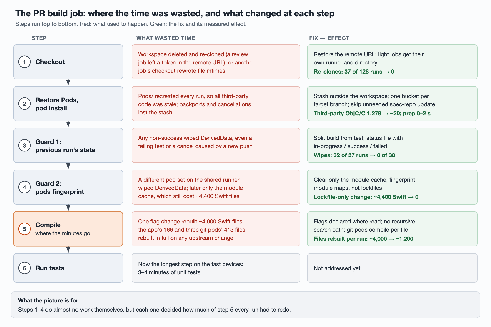

# From 46 minutes to 12: where an iOS PR build's time actually went

An iOS app's PR check runs one heavy job: build the app and its unit tests, then
run the tests. It runs on three self-hosted Macs that every PR shares. Before
this work, one run took 12–46 minutes depending on which Mac picked it up, and
the slowest queue waits passed 100 minutes because the slow machine sat busy
for most of an hour at a time.

Almost all of that time was compilation, and almost none of it was compilation
the PR actually needed. This article is the overview: the numbers, the order the
fixes landed in, and where each one acts in the job. Two companion articles cover
the two mechanisms in depth:

- [Keeping DerivedData and Pods warm on shared self-hosted runners](keeping-ci-build-caches-warm.md):
  everything that threw the build cache away, and why the first round of fixes
  missed two of them.
- [Why a one-line PR rebuilt 4,000 Swift files](stopping-swift-rebuild-cascades.md):
  with the cache intact, which modules made the incremental build cascade, and
  how they were cut.

The three runners are called device 1, 2 and 3 below. Device 1 is the fastest;
device 3 started out on an outdated Xcode environment, which mattered more than
anyone expected (section 6).

## 1. Results

Baseline is Oct 13–16, before any change landed. "Now" for devices 1 and 2 is
the window after the fourth batch of changes (Oct 20 evening to Oct 21 morning);
for device 3 it is Oct 22, after its Xcode upgrade.

**Compile time** runs from the start of the build step to the first test
starting. Only successful runs against the main development branch count.

| Device | Best | Median | Worst | Job median |
| --- | --- | --- | --- | --- |
| 1 | 1.3 min → 0.7 min (−49%) | 5.5 min → 1.2 min (−78%) | 8.4 min → 4.7 min (−45%) | 11.9 min → 4.5 min (−62%) |
| 2 | 10.4 min → 2.3 min (−78%) | 11.6 min → 2.4 min (−80%) | 17.0 min → 6.3 min (−63%) | 21.9 min → 6.1 min (−72%) |
| 3 | 30.7 min → 6.3 min (−79%) | 32.9 min → 6.8 min (−79%) | 42.2 min → 8.7 min (−79%) | 45.6 min → 11.7 min (−74%) |
| 1 + 2 combined | 1.33 min → 0.68 min (−49%) | 8.17 min → 2.33 min (−71%) | 16.96 min → 6.26 min (−63%) | — |

Samples: devices 1 + 2 went from n=75 to n=22; device 3 from n=31 to n=4, so its
"now" row is thin. "Best" is the least reliable column: even before the work,
device 1 occasionally had a run that compiled almost nothing.

**Queue wait** runs from the job being created to a runner picking it up,
across the whole pool, including failed and cancelled runs.

| Period | Runners | Runs | Median | p90 | Max | Over 15 min |
| --- | --- | --- | --- | --- | --- | --- |
| Baseline (Oct 13–16) | 3 | 159 | 1.3 min | 31.0 min | 106.3 min | 31 (19%) |
| After batch 4, overnight low traffic | 2 | 30 | 1.3 min | 16.6 min | 20.9 min | 3 (10%) |
| Only two runners, incl. a peak window | 2 | 33 | 1.7 min | 15.9 min | 69.7 min | 6 (18%) |
| Device 3 back (Oct 22) | 3 | 21 | 3 s | 2.0 min (−94%) | 2.6 min (−98%) | 0 |

Queues got shorter mainly because each job got shorter: 12–46 minutes down to
4–12, so a runner is held for less time. Device 3 used to take 30–46 minutes per
run, which amounted to permanently occupying one of three machines. With only two
runners, a peak window still produced a 70-minute wait. 21 runs after device 3
returned is not much; a few full working days are needed before trusting it.

Per device, queue wait is not a speed measure: a job lands on whichever machine
frees up first, and is recorded against that machine. Device 3 had the lowest
baseline median wait precisely because it was slow: it grabbed the next job the
moment a 30-minute run ended.

| Device | Wait median | Wait p90 | Wait max |
| --- | --- | --- | --- |
| 1 (n=67 → 18) | 1.4 min → 1.3 min | 40.0 min → 16.6 min | 106.3 min → 20.9 min |
| 2 (n=44 → 12) | 1.4 min → 1.7 min | 28.3 min → 8.1 min | 60.7 min → 20.6 min |
| 3 (n=48 → 8) | 0.8 min → 4 s | 27.0 min → 4 s | 54.2 min → 4 s |

## 2. Batch by batch

Changes landed in four batches. Job-time median per device, change relative to
the previous batch:

| Batch | What landed | Device 1 | Device 2 | Device 3 |
| --- | --- | --- | --- | --- |
| Baseline | — | 11.9 min | 21.9 min | 45.6 min |
| 1 (Oct 16 evening) | Pods no longer rebuilt, DerivedData no longer wiped | 9.8 min (−18%) | 15.5 min (−29%) | 31.2 min (−32%) |
| 2 (Oct 17–18) | Swift no longer cascades ~4,000 files | 7.2 min (−27%) | 10.8 min (−30%) | 17.2 min (−45%) |
| 3 (Oct 19 evening – 20) | Release-branch runs and cancellations stop losing the cache | 8.3 min (**+15%**) | 12.1 min (**+12%**) | removed from pool |
| 4 (Oct 20 evening on) | Fixes for the two slow-run patterns batch 3 exposed | 4.5 min (−46%) | 6.1 min (−50%) | 11.7 min (−32% vs batch 2) |

Cumulative against the baseline: device 1 −18%, −39%, −30%, −62%; device 2
−29%, −51%, −45%, −72%; device 3 −32%, −62%, n/a, −74%.

**Batch 1.** The `Pods/` directory is stashed outside the workspace instead of
being deleted and rebuilt; a pods-fingerprint change clears only the module
cache rather than all of DerivedData; generated compat headers are not rewritten
when unchanged and Swift decides staleness by content hash; a review job stops
leaving the workspace in a state that forces a fresh clone; a stale precompiled
header is deleted instead of failing the build. Third-party ObjC/C compiled per
run fell from 1,279 files to about 20.

**Batch 2.** Feature flags move out of one central module into the modules that
read them, and that module is deleted; three git-sourced pods compile per file
instead of whole-module; the app target drops a recursive search path; a failing
unit test no longer wipes DerivedData. The median number of files rebuilt per
run fell from about 4,000 to about 1,200.

**Batch 3** fixed rarer cases, and the median got worse anyway. On device 1,
three runs cleared the module cache only because `Podfile.lock` differed from the
previous PR's, each recompiling about 4,400 Swift files. Three runs wiped the
whole cache: one because the previous run was cancelled, two during the
changeover between the old and new workflow. Both causes are explained in the
cache article. Device 3 was taken out of the pool the same day (section 6).

**Batch 4** targeted exactly those: a cancelled or timed-out build keeps its
DerivedData; the spec-repo update is skipped when nothing needs it; a
lockfile-only change keeps the module cache (this last one landed after the data
window, so its effect is not in the numbers). Over the next 30 runs, the cache
was wiped zero times and pod preparation took 0–2 seconds. Of 22 successful
runs, 11 compiled 30 Swift files or fewer.

The batch-4 sample leans on consecutive pushes to the same few PRs, where
consecutive changes are small, so the median is optimistic. It also covers only
one overnight window.

## 3. Where in the job each fix acts

| Step | What was wasting time | Fix | Effect |
| --- | --- | --- | --- |
| 1. Checkout | The workspace was deleted and re-cloned, or another job's checkout rewrote file mtimes | Restore the remote URL a review job changed; move light jobs to their own runner and directory | Re-clones 37 of 128 runs → 0 |
| 2. Restore Pods, `pod install` | `Pods/` recreated every run; release-branch runs and cancellations lost the stash | Stash `Pods/` outside the workspace; separate caches per target branch; write back on early cancel; skip spec-repo update | Third-party ObjC/C 1,279 → ~20 files; pod prep ~2 min → 0–2 s |
| 3. Guard 1: previous run state | Any non-success, even a failing test or a cancel, wiped DerivedData | Split build and test; a three-state status file | Wipes 32 of 57 runs → 0 of 30 |
| 4. Guard 2: pods fingerprint | A different pod set on the shared runner wiped DerivedData, later just the module cache, which still recompiled ~4,400 Swift files | Clear only the module cache; fingerprint module maps, not lockfiles | Lockfile-only change: ~4,400 Swift files → 0 |
| 5. Compile | Changing one flag rebuilt ~4,000 Swift files; the app's 166 files and three git pods' 413 recompiled wholesale on any upstream change | Flags live where they are read; drop recursive search paths; per-file compilation for git pods | Rebuilt-files median ~4,000 → ~1,200; adding a flag 3,928 → 166 |
| 6. Run tests | Unit tests are now the longest step on the fast devices | Not addressed yet | — |

Each step's mechanism and evidence are in the companion articles: steps 1–4 in
[the cache article](keeping-ci-build-caches-warm.md), step 5 in
[the cascade article](stopping-swift-rebuild-cascades.md).

## 4. Anatomy of three runs

Three runs on device 3 show where the minutes went:

| Run | Total | Prep | Compile | Test + teardown | Swift / ObjC·C compiled |
| --- | --- | --- | --- | --- | --- |
| Before any change, DerivedData wiped | 41.7 min | 5.5 min | ≈34.2 min | ≈2.0 min | 4,298 / 1,279 |
| After batch 1, a typical run | 30.8 min | 4.0 min | 23.1 min | 3.7 min | 4,010 / 22 |
| After batch 1, PR touched only a leaf module | 11.0 min | 4.0 min | 3.3 min | 3.7 min | 28 / 0 |

The 11 minutes saved between the first two rows are almost all third-party ObjC/C
and precompiled modules. The gap between the second and third is the Swift
cascade: the incremental build itself was fine, and when nothing upstream had
touched a widely depended-on module, the whole run took 10–11 minutes.

## 5. The most recent runs

Batch 4 window, successful runs against the development branch:

| Device | Job | Build step | Swift / ObjC·C | Note |
| --- | --- | --- | --- | --- |
| 1 | 5.9 min | 139 s | 2,424 / 4 | ~2,400-file cascade |
| 1 | 5.8 min | 137 s | 2,475 / 0 | same |
| 1 | 4.3 min | 42 s | 1 / 0 | |
| 1 | 6.0 min | 146 s | 2,425 / 0 | ~2,400-file cascade |
| 1 | 4.2 min | 44 s | 383 / 0 | app still recompiled wholesale (open question) |
| 1 | 3.9 min | 17 s | 0 / 0 | previous run cancelled during tests; cache kept |
| 1 | 7.9 min | 261 s | 4,518 / 0 | a device-info pod's version bumped; module cache cleared |
| 1 | 7.7 min | 251 s | 4,520 / 0 | same pod switched back |
| 1 | 4.6 min | 61 s | 402 / 0 | |
| 1 | 4.0 min | 31 s | 8 / 0 | |
| 1 | 4.5 min | 49 s | 27 / 4 | |
| 1 | 4.0 min | 31 s | 8 / 0 | |
| 1 | 4.1 min | 34 s | 6 / 0 | |
| 1 | 3.9 min | 16 s | 0 / 0 | |
| 1 | 9.2 min | 258 s | 4,110 / 140 | module maps changed; real dependency change |
| 2 | 6.2 min | 80 s | 8 / 4 | |
| 2 | 10.1 min | 290 s | 2,423 / 0 | ~2,400-file cascade |
| 2 | 6.3 min | 83 s | 6 / 0 | |
| 2 | 6.0 min | 71 s | 9 / 0 | |
| 2 | 6.1 min | 87 s | 386 / 0 | app still recompiled wholesale |
| 2 | 6.1 min | 79 s | 22 / 0 | |
| 2 | 6.1 min | 63 s | 4 / 4 | |

The cache is no longer being thrown away. Warm runs take about 4 minutes on
device 1 and 6 on device 2, and the difference is mostly unit tests. Every slow
run left is a large batch of first-party Swift: three module-cache clears
(4,110–4,520 files, two of them a dependency's version flipping back and forth
between PRs) and four cascades of about 2,400 files whose root has not yet been
traced.

## 6. The machine was part of the problem

Device 3 was 6× slower than device 1 on a cold build (34 vs 5.6 minutes) and
was assumed to simply be a slower machine. On Oct 20 an upgrade left it with only
a newer major Xcode that could compile but not produce archives matching the
other machines, and its runner environment still pointed at the deleted older
Xcode, so `git` could not even start and the job died before `pod install`. It was taken out of the pool that
day.

It came back on Oct 22 with a current Xcode. Its first cold build, about 6,100
files, took **6.3 minutes**. The same build used to take 29–35. Its old Swift
compiler had also rejected the content-hash flag that devices 1 and 2 had been
benefiting from since batch 1; the new one accepts it. Most of what looked like
"device 3 is slow" was its toolchain environment.

Three things remain on it: warm runs there still recompile 3,600–4,100 Swift
files each, unexplained so far; free disk space was down to 40 GB before the
upgrade; and one build failed in `pod install` for a missing UTF-8 locale
setting, which has not recurred but should be pinned in the runner environment.

## 7. What is left

- **Unit tests.** On devices 1 and 2, warm compile is about 70 seconds and unit
  tests are the longest step: medians of 188 s and 244 s. Several test groups
  take 11–16 seconds each, which looks like waiting on real timers. Pod-related
  steps add about 40 seconds. None of this has been touched.
- **The ~2,400-file cascade.** Twelve runs so far recompiled 2,370–2,475 Swift
  files. A count that stable looks like the full downstream of one module. The
  plan is to split the log by target, find the lowest module rebuilt, and
  compare against what merged in between: if it is another widely depended-on
  module that changes often, split it the way the flag module was split.
- **Nine runs where the app recompiled wholesale** despite a small upstream
  change. See the cascade article.
- **More data.** Batch 4 had 7–15 development-branch runs per device, skewed
  toward consecutive pushes. A week of working days is needed before calling
  the medians stable.

## 8. How the numbers were measured

- Timings come from the CI provider's jobs API and job logs. "Compile time" is
  from the build step starting to the first test starting; for the latest
  windows it is the duration of the `build-for-testing` step, which adds an
  extra `xcodebuild` launch of a dozen seconds, so reductions are if anything
  understated.
- Compiled file counts are the `Compiling` lines in the log, deduplicated by
  target where noted (the difference from raw counts is under 1%).
- Only successful runs against the development branch count toward medians.
  Failures, cancellations, runs that skipped compilation, and manual
  verification runs are excluded.
- Evidence comes in three grades, and the companion articles label each claim:
  **CI-measured** (real CI runs), **local** (local Xcode), and **estimated**
  (derived from the other two). An estimate stays an estimate until a CI run
  confirms it at the same scale. Several did not survive that, and the
  companion articles say which.
