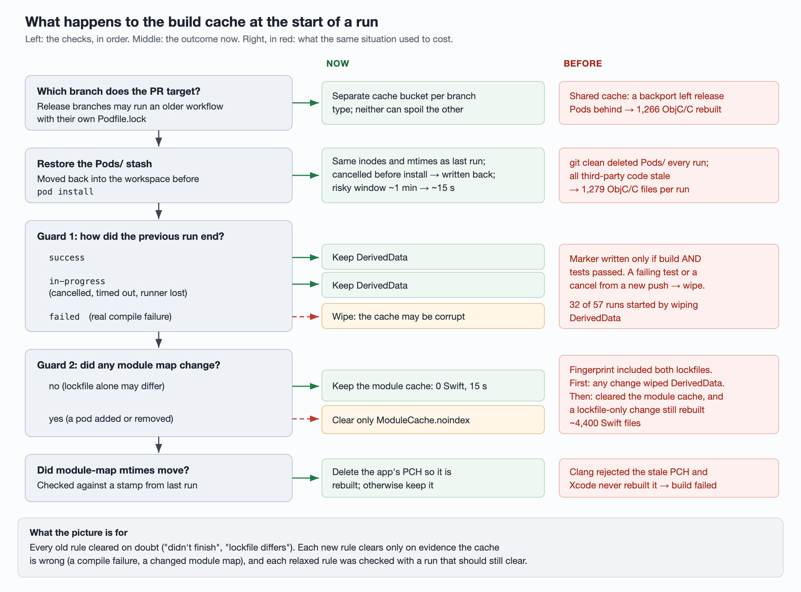

# Keeping DerivedData and Pods warm on shared self-hosted runners

A self-hosted Mac runner can keep Xcode's DerivedData and CocoaPods' `Pods/`
between jobs, and an incremental build on a warm cache is minutes faster than a
cold one. That only helps if the cache survives. On a runner shared by every PR,
it rarely did: in the baseline window, 32 of 57 runs started by wiping
DerivedData, and every run recreated `Pods/` from scratch.

This article walks through everything that threw the cache away, in the order
the job runs, and what replaced each one. Part of a series; the
[overview](cutting-pr-build-time.md) has the overall numbers, and
[the cascade article](stopping-swift-rebuild-cascades.md) covers what happens
once the cache is intact.

The rule underneath it all: **a cache should be cleared only when it is known to
be wrong, not when the previous run merely did not finish cleanly.** The
original guards cleared on any doubt. Most of the work was turning "any doubt"
into specific, checkable conditions.

## 1. Checkout: a fresh clone means everything is new

**A review job left a credential in the remote URL.** An AI code-review job
rewrote the workspace's `origin` to a token-bearing URL and never restored it.
The next job's checkout action saw an unexpected remote, deleted the workspace
and cloned again. Every file then had a fresh mtime, and every first-party Swift
file recompiled.

Fix: the review job restores `origin` and removes the token when it ends.
*CI-measured:* before, 37 of 128 runs were re-clones (14 of 45 on the busiest
day). After, 16 runs in a row cleaned the existing repository instead, zero
re-clones, where 31% predicted about five. That included a run that started two
seconds after the review job finished on the same machine.

**Other jobs checked out other refs in the same workspace.** Lint, guardrail and
review jobs each checked out their own PR's merge commit into the same directory,
rewriting the mtimes of whatever differed. The next build cascaded from those
files. In one confirmed case a job checked out a branch with an old base,
touching 51 files, including a debug-tweaks module low in the dependency graph.

Fix, part 1: when hosted-runner minutes ran out, 24 light jobs moved onto a
separate light runner process on the same Macs, and the 16 that check out code
use their own directory beside the build workspace. Each light runner costs
about 2.5 GB of disk; there are four. A required check now also rejects
workflows that reintroduce hosted runners. *CI-measured:* the same commit built
twice on device 2 with a light job's checkout in between: 357 Swift files the
first time, **0** the second.

Fix, part 2, which turned out to make part 1 unnecessary for the rest: once
Swift decides staleness by content hash rather than mtime (see the
[cascade article](stopping-swift-rebuild-cascades.md)), rewritten mtimes on
unchanged content cost nothing. Over three days, 21 runs had another PR's
checkout between them and their predecessor; their build median was 88 s,
against 105 s for the 29 runs without. The two worst interleavings rewrote 27
and 56 source files and led to compiling 1 and 6 Swift files. The remaining jobs
were left in the shared workspace.

## 2. Restoring Pods and `pod install`

**`Pods/` was recreated every run.** The checkout's `git clean` deleted the
untracked `Pods/` directory. `pod install` recreated it with new inodes and new
mtimes, so everything downstream was stale: every third-party ObjC/C file, every
precompiled module.

Fix: at the end of a job, move `Pods/` to a stash outside the workspace; after
the next checkout, move it back unchanged before `pod install`. A follow-up made
the stash step skip, instead of failing the job, when the project-generator
script it relies on is absent. *Local:* a warm build went from 7,652 tasks to 0,
22 seconds. *CI:* every run after the change logged `Restored 2 of 2`. Together
with the fingerprint change below, third-party ObjC/C per run fell from
**1,279 to about 20**.

**A stale precompiled header failed the build.** A fresh `pod install` rewrites
module maps' mtimes. Clang then rejects the app's PCH ("has been modified since
the precompiled header was built"), and Xcode does not rebuild it, so a
guardrail build failed twice in a row on one machine. Fix: record the module
maps' mtimes; when they change, delete the PCH so it is rebuilt. *CI:* the
guardrail passed 3 of 3 afterwards, two of them on the machine that had been
failing. Cost: one PCH rebuild and two ObjC files the first time each runner
saw the stamp, and rarely after.

**Release-branch PRs shared the cache with an older workflow.** Backport PRs
to release branches also run the build job. A PR run uses the workflow file from
its own merge commit, so a release branch cut before these changes runs the old
workflow, with its own `Podfile.lock`, while writing the same DerivedData and the
same Pods stash as development-branch runs. Two failure modes followed:

- An old-workflow run that failed a test did not write the success marker, so
  the next development run on that machine wiped DerivedData (4,803 Swift, 1,270
  ObjC/C).
- The stash now held the release branch's Pods. The next development run could
  not restore it (`Restored 0 of 2`) and recompiled all 1,266 third-party ObjC/C
  files.

Fix: one cache bucket for the development branch and one for release/hotfix
branches. Release branches running the old workflow only ever touch the old
paths, so no release branch needed editing; branches cut later carry the split.
When free disk drops below 50 GB, a development run deletes the release bucket
(about 13 GB); a release run never deletes its own. That last rule exists
because the first version had release runs delete their own bucket under low
disk, a guaranteed pointless cold build, caught in review of a later change.

*CI-measured:* on device 2, in order: a cold development build (4,803 / 1,270),
someone else's development PR, a release branch on its own workflow, then
development again. The final run restored both stashes, kept DerivedData,
compiled 1 / 0 files, build step 56 seconds. Later, a backport failed `pod
install` on a project-file merge conflict; its old workflow did not write back
its stash, so the next backport restored nothing, but every development run on
that machine afterwards still restored both and compiled 4–386 Swift files.

**Cancellation around `pod install` lost the stash.** Restoring moved the stash
out and deleted it; it was written back only after `pod install` succeeded.
Pushing a new commit cancels the PR's running job, and `pod install` took 1–2
minutes, mostly walking the spec repo looking for lock files and updating it.
Cancellations landing in that window were common. One cancelled 56 seconds
into `pod install`; the next run restored nothing and recompiled 1,266 ObjC/C
files.

Fix, in two parts:

1. If the run is cancelled before `pod install` starts, write the restored Pods
   back to the stash. If it is cancelled *during* `pod install`, still do not:
   half-downloaded Pods would not match the old `Manifest.lock`, and the next PR
   could compile against the wrong sources.
2. Shrink the window. Lock-file cleanup and `bundle install` move into a new
   *Prepare CocoaPods* step before `pod install`, along with the spec-repo
   update; lock cleanup checks only git's lock files instead of walking the whole
   spec repo.

*CI-measured:* Prepare + `pod install` went from 80+47 and 79+59 seconds to 39+14
and 36+15 seconds. The window in which a cancel loses the stash went from about a minute
to about 15 seconds. Cancelling 19 seconds into Prepare, and separately during
the spec-repo update, both left the next run with `Restored 2 of 2` and build
steps of 28 and 41 seconds; three planted git locks were all cleared. Not
covered: the fallback to `pod install --repo-update` when the Prepare update
fails has never triggered on CI.

**Most runs did not need a spec-repo update at all.** After the above, Prepare
still took about 29 seconds on device 1: 4 s to fetch, 24 s for a hard reset of
the spec repo, longer than the `pod install` that followed. (`bundle install`
took 0.3 s and was left alone.) Fix: check whether every pod version locked in
`Podfile.lock` is already present in the local spec repo with a matching
checksum; if so, skip the update, otherwise update and list what was missing.
*CI-measured:* a skip took Prepare to 1 second. Positive control: adding a pod
version published two minutes before the push was detected as missing,
updated (31 s), and installed. After the change, 23 of 30 runs skipped, and all
22 successful development runs spent 0–2 seconds in Prepare.

## 3. Guard 1: did the previous run succeed?

The original rule wrote a success marker only if both build and tests passed,
and wiped DerivedData at the start of any run that found no marker. A failing
assertion leaves DerivedData perfectly valid; it was wiped anyway.

**Step one: split build from test.** Build with `build-for-testing`, write the
marker as soon as that succeeds, then `test-without-building`. *CI-measured:*
with a deliberately failing test, the build passed and the tests failed; 26
seconds later the next run on the same machine kept DerivedData and compiled 0
files. Cost: about 12 extra seconds before tests plus a one-second marker step.
Seven runs since the start of the month had compiled successfully and then not
succeeded (two test failures, five cancelled during tests); none of them would
have wiped the cache under the new rule. A flaky unit test that had once caused
exactly this was also fixed.

Cancellation *during compilation* still wiped, deliberately at the time. It
happened often: a push cancels the previous run mid-build, and the next one,
finding no marker, cold-builds. One such pair cost 38.4 minutes on device 3.

**Step two: three states instead of a marker.** Before building, write
`in-progress`. On completion write `success` or `failed`. A cancelled or
timed-out run never gets to write, so it stays `in-progress`, and the next run
**keeps** DerivedData for that state. Only `failed` clears, because a real
compile failure can come from a corrupt cache.

*CI-measured:* a run cancelled mid-build was followed on the same machine by a
run logging `Previous build was cancelled, timed out or lost its runner; keeping
warm DerivedData`, build 2 min 22 s. Positive control: a deliberate type error
was recorded as `failed`, and the next run cleared and cold-built (5 min 5 s).
In the following 30 runs DerivedData was wiped zero times, against three the day
before. The keep-on-cancel path then fired in production two days later.

**Changeover cost.** The new logic deletes the old marker file. If the same
machine then runs the *old* workflow, a rerun of a run created before the merge,
or a PR stacked on an old branch, that run finds no marker and wipes. This
happened twice on the first day and not again.

## 4. Guard 2: did the pod set change?

The second guard fingerprinted `Podfile.lock`, `Manifest.lock` and every module
map, and wiped DerivedData when the fingerprint changed. On a shared runner,
consecutive PRs often have different pod sets: 7 of 16 consecutive runs saw a
change.

**Step one: clear only the module cache.** On a fingerprint change, delete
`ModuleCache.noindex` and keep the rest of DerivedData. *Local:* C compilations
1,278 → about 500, precompiled modules 1,251 → 74, no module-map errors across
nine controlled pairs. *CI:* only one of eight fingerprint changes wiped
DerivedData, and that was guard 1 after a cancel. Runs that kept DerivedData
compiled 0–102 ObjC/C files, mostly about 20, whether or not the fingerprint had
changed. That is fewer than the local estimate of 500.

**Step two, found later: the module cache costs Swift, not ObjC.** Three runs
on one day logged "module maps unchanged" yet cleared the module cache because
the lockfile differed (one PR had added five dependencies to one page module).
Each recompiled 4,369–4,380 Swift files across 152 unrelated targets.

Fix: drop both lockfiles from the fingerprint and hash only the module maps. A
lockfile-only difference keeps the module cache.

- *CI-measured:* a lockfile-only change kept the cache and compiled **0 Swift
  files, in 15 seconds**, where it used to take 6–7 minutes.
- *Positive control:* a probe calls APIs that only exist in the new version of a
  dependency, so a stale cache would fail to compile. Upgrading a SQLite
  wrapper by a patch version, adding a header to an ads SDK, and swapping a
  binary SDK's `.swiftinterface` all kept the cache, compiled, and rebuilt only
  the affected `.pcm` files. Adding or removing a pod changes the set of module
  maps, so it still clears.
- *Limits:* upgrading a widely imported dependency still recompiles a lot
  (4,308 and 3,729 files in two tests). That is a real dependency change and
  would happen with or without the cache. Each runner clears once after the
  change, because the fingerprint format changed.
- *In production:* the new path logged `Podfile.lock changed but no module map
  did; kept ModuleCache.noindex` twice on device 3. Both runs still recompiled
  3,742 and 4,120 Swift files, which may come from other upstream changes; not
  yet checked.

Two runs in the batch-4 window with an unchanged module map but a changed
fingerprint were a device-info pod switching back and forth between two
releases from one PR to the next. Its source really changed, and the shared UI
kit imports it, so they do not count as lockfile-only samples.

**Dropped: clearing per pod.** The plan was to delete only the changed pod's
`.pcm` files and those downstream. After step one, the ObjC/C counts with and
without a fingerprint change were nearly identical, so the cost was no longer
measurable and not worth maintaining a dependency graph by hand. Step two
handled the Swift side more simply.

## 5. What the first round of fixes missed

The Pods stash, the module-cache-only clear, the PCH stamp and the build/test
split were each verified on development-branch PRs. They all assumed that every
run on a runner uses **the same workflow and the same Pods, and runs to the
end**. Two kinds of run broke that.

| Missed case | Why earlier fixes did not cover it | Consequence | Fix |
| --- | --- | --- | --- |
| Release-branch PRs running their own older workflow | A PR run uses the workflow file in its merge commit. Release branches cut before the changes keep the old version, but write to the same DerivedData and stash. Once backports started running the build job, the two kinds alternated on the same machines | Device 1: a backport's failed test led to a wipe and 4,803 / 1,270 files. Device 2: the stash held release Pods; the next run recompiled 1,266 ObjC/C | Separate buckets |
| Runs cancelled around `pod install` | The stash was deleted on restore and written back only after a successful install. Only complete runs were tested. Every push cancels the PR's running job, and the install took 1–2 minutes | A run cancelled 56 s into `pod install` led to `Restored 0 of 2` | Write back on early cancel; shorter window |

The common cause: each change was verified only on "a development PR runs the
whole job". Nobody first listed **who else writes these cache directories**
(release branches on an older workflow) and **where a run can stop** (any step
can be cancelled). Neither reproduces locally. They have to be staged on CI as
sequences: "backport, then development run", "cancel at step N, then run".

## 6. The day that looked like a regression

The day after the third batch landed, medians went *up* 12–15% on both fast
devices. Successful development runs that day, one device's timeline:

| Build step | Swift / ObjC·C | Cause |
| --- | --- | --- |
| 403 s | 4,375 / 0 | lockfile differed from previous PR; module cache cleared |
| 387 s | 4,369 / 0 | same |
| 414 s | 4,380 / 9 | same |
| 169 s | 118 / 0 | fingerprint changed, small upstream change |
| 61 s | 35 / 0 | |
| 38 s | 6 / 0 | |
| 312 s | 4,821 / 1,272 | full wipe: an old-workflow run found no old marker |
| 164 s | 274 / 5 | |

and on the other device: one full wipe after a cancelled run (4,814 / 1,270),
one full wipe from a rerun on the old workflow, and a 52-second build that
compiled 3 / 0.

The cache itself was healthy: the four builds that cleared nothing took 38–107
seconds. Three things slowed the day down: a lockfile-only change clearing the
module cache (three runs), a cancel causing a full wipe (one), and two marker
formats alternating (two, a one-off). The next batch fixed the first two, and
the third did not recur.

## Takeaways

- **Clear on evidence, not on doubt.** "The previous run didn't finish" and
  "the lockfile changed" are both doubts. "The previous build failed to
  compile" and "a module map changed" are evidence.
- **Before verifying a cache fix, list the writers and the stop points.** Who
  else writes this directory, on which workflow version? At which steps can a
  run end? Then stage each combination on CI.
- **Shorten the windows you cannot close.** A cancel during `pod install` must
  still discard the stash; moving slow work out of that step made the window
  four times smaller.
- **Keep a positive control for every "keep".** Each relaxed guard was paired
  with a run that *should* clear, to prove it still did.
