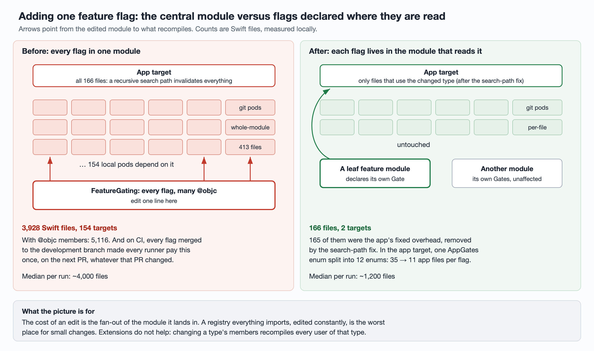

# Why a one-line PR rebuilt 4,000 Swift files

Once a CI runner stops throwing away its build cache (see
[the cache article](keeping-ci-build-caches-warm.md)), the next question is why
an incremental build still recompiles most of the app. In this project the answer
was concrete: of 18 warm runs, 15 recompiled **3,714–4,294** first-party Swift
files, for PRs that touched one or two. This article covers where those cascades
started, the four structural changes that cut them, and how each was verified.
Part of a series; the [overview](cutting-pr-build-time.md) has the overall
numbers.

The app is split into about 160 local CocoaPods modules plus the app target
(166 Swift files) and a unit-test target.



## 1. Where the cascades started

Splitting each run's log by target and finding the lowest module recompiled
gave the same three answers in every ~4,000-file run:

| Root module | Pods downstream |
| --- | --- |
| `FeatureGating`, every feature flag in one place | 154 |
| `GatingShared`, shared flag plumbing | 159 |
| `DesignSystem`, shared UI components | 155 |

Two things made these roots fire on PRs that never touched them.

**CI builds the merge commit.** A PR check builds the PR merged with the latest
development branch. One confirmed run: the PR's new commit changed one file in a
feed-cell module and one in the app. Between that run and the previous one, the
development branch merged a change to the debug-tweaks module and the flag
module. The build recompiled 156 targets starting from `FeatureGating`. The
feed-cell module itself has only 18 downstream pods. Every flag change merged to
the development branch therefore costs **every runner** one ~4,000-file rebuild
on its next job. On one day, four such merges landed.

**Leaf changes really were cheap.** A run whose new commit touched one file in a
leaf page module recompiled 28 Swift files; none of the module's 7 downstream
pods rebuilt. Total job: 11 minutes, against 30 for a typical run then. The
incremental build was working. The dependency graph was the problem.

A second, now-fixed source: another job checking out an older branch in the same
workspace rewrote mtimes of 51 files, including the tweaks module, and the next
build cascaded from there. Content hashing (section 6) has since made this
harmless.

## 2. What kinds of change cascade

Before restructuring anything, four kinds of change to the feed-cell module were
measured locally:

| Change | Swift files / targets rebuilt | Time |
| --- | --- | --- |
| Function body only (public or internal) | 1 / 1 | 22–25 s (no-op build: 22 s) |
| Add a public member to an existing type; add a default argument to a public method; change an internal method's signature | 248 / 6 | 51–58 s |
| Add a new top-level type (public or internal, same result) | 1,151 / 22 | 110–115 s |

In the 248-file case, downstream pods only recompiled files that used the
changed type (6 and 3 files in two modules). The other **230 files were a fixed
overhead** paid on any interface change: all 166 app files and all 64 files of
one git-sourced pod. Sections 4 and 5 remove both.

A new top-level name rebuilt 19 downstream pods, including one with 185 files
that does not import the module at all. In the last 90 days, 6 of the module's 33
commits added or removed a top-level name, about once every two weeks. For the
other 27, turning the module's types into protocols would save at most 9 files,
so that idea was shelved. A cleanup that removed 22 unused imports of the module
and declared dependencies the podspec had been missing left the dependency graph
unchanged and had no measurable effect.

## 3. Flags declared where they are read

The central flag module was the root of almost every cascade, so flags moved
out of it.

**The old shape.** Every flag was a member of one type in `FeatureGating`. Many
were `@objc` so ObjC could read them. Adding one flag, measured locally:

| Declaration | Swift files rebuilt |
| --- | --- |
| Central type, `@objc` member | 5,116 |
| Central type, plain member | 1,220 |
| New `Gate` declared in the module that reads it | 182 |

Removing one formerly `@objc` flag went from 5,088 files and 398 s to 357 files
and 198 s.

**The new shape.** A small `Gate` type declared next to the code that reads the
flag. Only the 25 flags ObjC needs stay `@objc`. A preparatory batch gave `Gate`
the remaining shapes: kill switches and `Int`/`Double`/`String` configs. It also
froze the 303 remote-config keys so moving a declaration could not rename one,
and deleted flags nobody read. Measured locally, adding one flag:

| Where it is declared | Swift files / targets |
| --- | --- |
| Old central module | 3,928 / 154 |
| A per-domain gates module (e.g. `ArticleGates`) | 170 / 4 |
| A leaf module, or an ads module with 47 downstream pods | 166 / 2 |

165 of those 166 are the app target's fixed overhead, removed in section 5.

**The migration had its own cost.** Each migration batch edits the shared
plumbing module, so each one costs every runner one ~4,000-file rebuild. One run
on device 2 recompiled 4,064 files starting from `GatingShared`. That is why 11
planned batches were merged into 5. When the last batch landed, every runner paid
one more cascade from `GatingShared` (4,552 and 4,564 files on its first run).
After that, cascade roots that day were an ads bidding kit (50 downstream) and a
wrapper around a third-party analytics SDK (122 downstream). No flag module appeared again.

The last batches moved every flag out and deleted `FeatureGating`. They also
moved 106 debug tweaks out of the tweaks module. The final tweak was read by an
external repository; once that repository switched to having the app write the
value, the `AppTweaks` module was deleted outright. A check now stops external
pods from adding new dependencies on local pods.

One of these PRs changed 1,157 files, beyond the 300-file limit of the code
host's PR diff API. The static-check and review jobs switched to `git diff` so
large PRs are reviewed in full.

**Keeping it from coming back.** Lint turns both old declaration styles into
errors. A required PR check replaced the old static-check job and rejects
re-centralizing flags into one module. PRs already open had to push once more to
pick it up.

### The same lesson, inside the app target

The app's own flags lived in one `AppGates` enum. Changing any app flag
rebuilt every file that used `AppGates`. It was split into 12 per-domain enums
(`PushGates`, `FeedGates`, ...), and the required check rejects recreating
`AppGates`.

*Local:* adding a flag to `AppGates` rebuilt 35 app files plus 2 test files in
28 s; adding one to `PushGates` rebuilt 11 + 2 in 27 s (12 at most). Changing a
key string: 35 → 11. The seconds barely moved because of about 24 s of fixed
overhead.

Two non-obvious findings:

- **`extension AppGates` is no cheaper than editing the enum.** It rebuilt 35 app
  files plus 89 test files. When a type's members change, every file that uses
  the type recompiles, wherever the member was declared. Independent enums are
  the only shape that isolates them.
- **A domain's first gates file costs one big rebuild.** It adds a new top-level
  name to the app module, so all 89 unit-test files recompile once. Later
  changes in that file do not.

## 4. Git pods compiled whole-module in Debug

A Podfile `post_install` hook compiled every pod not installed from a local
`:path` with whole-module optimization in Debug. The reasoning was sound for
third-party pods: they never change locally, so whole-module is fastest. But
three git-sourced pods (64, 339 and 10 Swift files) **depend on local pods**.
One of them depended on 131 local pods, including the flag and tweaks modules.
Whenever an upstream interface changed, each recompiled in full.

Fix: compute the list from the pod dependency graph rather than hard-coding it.
Any non-local pod that imports a local pod compiles incrementally in Debug. The
same check caught nine local pods' unit-test targets (39 files) that had been
misclassified as whole-module because their names were not in the local-pod
list. Whole-module Debug configurations: 181 → 166.

*Local:* a public member added to a type in `DesignSystem` rebuilt 622 → 177
Swift files. The three git pods went 339 → 3, 64 → 0, 10 → 0, test targets 35 →
0; the remaining 166 were the app. Reverting to the old Podfile reproduced
339/64/10.

*Local, honestly:* on an 18-core machine, wall time did not change (incremental
73 → 72 s, cold 333 → 335 s, one run each). The app's 166 files are the critical
path, and these pods compiled in parallel with them.

*CI-measured:* switching compilation mode costs one full per-file build of these
pods per runner (64 / 339 / 10 files), paid once. A runner that switched branches
in between paid it twice, visible when Xcode deleted the test targets' old
products. After that, 114 consecutive logs printed the incremental list, and
no whole-module build of these pods appeared again. In two cascades from
`GatingShared` with a warm cache, the three pods compiled 0 files each, where 13
earlier cascades had compiled all of them. Only two samples exist because, with
the flag module gone, such cascades became rare. In eight ~2,400-file cascades,
two of the pods compiled 0 files and the 64-file one compiled 63–64 per file. It
also often compiled 56–61, a partial count whole-module mode cannot produce.
Every run where the 339-file pod compiled in full was a cache wipe, a
module-cache clear, or a 4,000+ cascade.

## 5. A recursive search path made the app recompile in full

Even a change used by two app files rebuilt all 166. The driver said why:

```
No fingerprint in swiftmodule: Invalidating all nodes in newer: module.modulemap
```

The app target's `FRAMEWORK_SEARCH_PATHS` and `USER_HEADER_SEARCH_PATHS`
contained `$(SRCROOT)/**` and `$(PROJECT_DIR)/**`. These expand to about 1,000
relative `-F` and `-iquote` flags. Through one of those relative paths, Clang
found a third-party SDK's `module.modulemap` inside `Pods/`, and recorded the
dependency under that relative path. The Swift driver judged that file "newer"
on every build. A module map is not a `.swiftmodule` and carries no fine-grained
dependency information, so the driver had to invalidate every node: all 166
files.

*Local control:* with the recursive entries removed from the app's Debug
configuration, the app still built. The same default-argument change rebuilt the
app's files 166 → 1, twice.

Combined with section 4, the feed-cell signature change from section 2 went
from 248 files to 19, and from 67 s to 33 s.

**Verifying a search-path change is safe for release.** Debug builds passing
proves little about archives. Before merging, the branch went through the real
beta pipeline: archive, sign and upload all passed, with no `ld: warning` or
`file not found`, and 953 warnings against 964 for a development-branch build
the same night. Locally, two Release products, before and after, were compared
on the files the compiler read, the libraries linked, and the symbols exported
and referenced. The difference was zero.

*CI-measured:* before the change, any upstream change made the app recompile
166 or 167 files. Over the next 96 compiled runs, excluding each runner's
first:

| App files recompiled | Runs |
| --- | --- |
| 0 | 27 |
| 1–11 | 15 |
| 12–164 | 15 |
| 165+ | 39 |

Before the change, 12 of 15 compiled runs were 166/167, one was 164, and two did
not compile the app. Of the 39 runs still at 165+: 10 had DerivedData wiped, 11
had the module cache cleared after a fingerprint change, 1 had no Pods restored,
1 unknown, all expected; 7 were wide cascades of 2,370–4,076 Swift files.

**Open:** the other 9 compiled only 273–419 Swift files, yet the app recompiled
165–178 and **all 89–92 unit-test files** recompiled too. In 7 of them, one
coordinator module also rebuilt 104–116 files. The whole test target
recompiling means the app's interface changed, likely a PR adding or removing a
top-level name in the app. The diffs have not been checked one by one. If that
is not it, the next step is reproducing locally with
`-driver-show-incremental`.

The median number of files rebuilt per run went from about 4,000 to **1,217**
on the first working day after sections 3–5 landed.

**Estimate that could not be confirmed at scale.** Sections 4 and 5 together
should save the app's 166 files on every upstream interface change, plus 413
git-pod files on every flag cascade. That is about 14% of a 4,000-file cascade,
or 3–4 minutes per run at device 3's old compile rate. But with the flag module
gone, warm-cache 4,000-file cascades stopped happening on device 3, so there was
nothing at the same scale to compare. The four warm runs it did have compiled in
4.5–10.5 minutes (156–1,192 Swift files).

## 6. Content hashing instead of mtimes

Two smaller changes landed with the first batch:

- **Don't rewrite unchanged compat headers.** The Swift-generated ObjC compat
  header was rewritten on every build, bumping its mtime and invalidating its
  ObjC importers. It is now written only if its content changed.
- **Let the Swift driver compare file content.** Where the compiler supports
  `-enable-incremental-file-hashing`, it is passed, so a file whose mtime
  changed but whose content did not is not recompiled.

*Local:* after a pod-set change, 6,491 → 2,545 Swift files; after a fresh clone,
4,702 → 618.

*On CI, at first, no visible effect.* Runs with a fingerprint change still
recompiled about 4,000 files. The local reduction was recorded as "not reproduced
on CI". Three days later it turned out the hashing *was* working on devices 1
and 2. The 4,000 files came from the module-cache clear, which content hashing
cannot help with (see the cache article). The direct evidence came from another
job checking out a different PR in the same workspace: rewriting 27 and 56 source
files led to compiling 1 and 6.

Device 3's Swift 6.2.4 did not recognize the flag; the workflow detected that,
printed a notice and left it off. After its Xcode upgrade it accepted the flag.

**Bridging header removed.** The app's bridging header made an internal ObjC
engine implicitly visible to 252 files; without it, 14. A "module not defined"
error that appeared on every build went away. The effect on build time was not
measured.

## Takeaways

- **Find the root, not the count.** "4,000 files" says nothing; "4,000 files
  starting from the flag module, which 154 pods depend on" says what to fix. Split
  the log by target and find the lowest module rebuilt.
- **Remember CI builds the merge commit.** A PR pays for whatever the development
  branch merged since the runner's last job. A module that is both widely
  imported and frequently edited taxes every runner on every merge.
- **Declare things where they are read.** Central registries of flags, configs
  or tweaks are the worst shape for incremental builds: one tiny edit, maximal
  fan-out. Extensions do not help; separate types do.
- **Read the driver's own explanation.** `-driver-show-incremental` and lines
  like "Invalidating all nodes" pointed straight at a recursive search path that
  nobody would have suspected.
- **Measure wall time as well as file counts.** Removing 413 files from a
  cascade did not move local wall time, because they were not on the critical
  path. Fewer files is not always faster.
